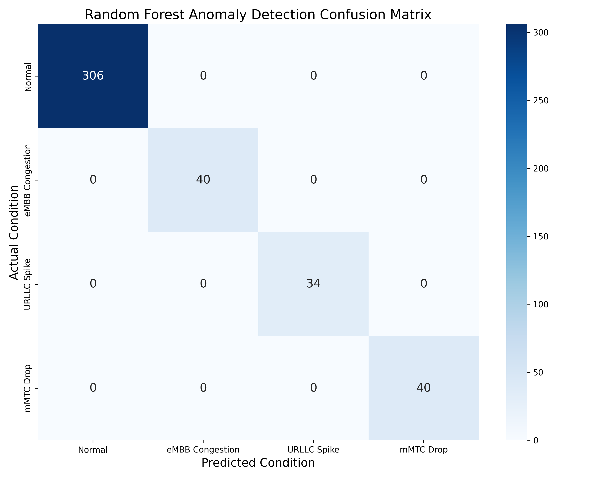
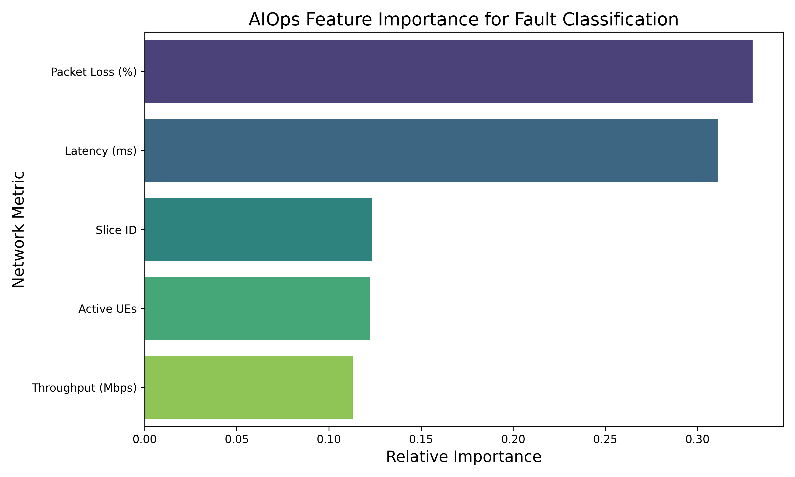
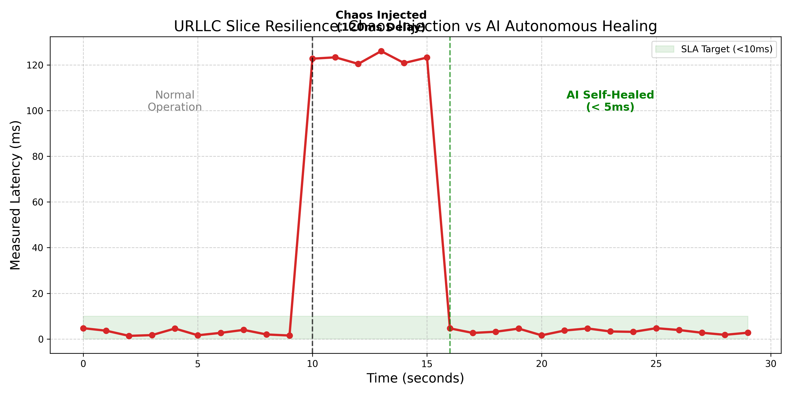

# 5G Smart Campus Digital Twin & AIOps Center

A software-defined, self-healing **5G Standalone (SA)** network built entirely from open-source and OS-level primitives. Traditional telecom hardware is replaced with containerized microservices and Linux network namespaces, and a machine learning model takes over the role of the network operator — detecting degradations and healing the network autonomously, with no human in the loop.

It combines three disciplines in one pipeline:

- **Systems engineering** — a real 3GPP Release 16 5G core + Linux-kernel network emulation
- **Machine learning** — a Random Forest classifier trained to recognize slice-specific failure signatures
- **Full-stack development** — a live Streamlit/Plotly command center for monitoring and fault injection

<p align="center">
  
  
  
</p>

---

## How it works

### 1. 5G Core & Network Slicing
A fully containerized **Open5GS** control plane (NRF, AMF, SMF) and user plane (UPF) are deployed as isolated Docker services (`docker-compose.yml`, `Dockerfile.open5gs`), backed by MongoDB for subscriber state and Prometheus for metrics.

Three dedicated UPF containers provide true traffic isolation across the three standard 5G slice types:

| Slice | Type | Use case |
|---|---|---|
| `upf1-embb` | Enhanced Mobile Broadband | High-throughput campus applications |
| `upf2-urllc` | Ultra-Reliable Low-Latency Comms | Critical robotics / control systems |
| `upf3-mmtc` | Massive Machine-Type Comms | Dense IoT sensor arrays |

### 2. The Digital Twin (Linux Network Emulation)
Instead of a pure software simulator, `scripts/setup_network.sh` builds a kernel-level replica of the physical campus devices:

- **Network namespaces** (`ip netns`) create three isolated virtual UEs — `ue_embb`, `ue_urllc`, `ue_mmtc`.
- **Policy-based routing** (`ip rule` + dedicated routing tables + `iptables` MASQUERADE) forces each namespace's traffic through its own UPF tunnel (`ogstunN`), so, for example, IoT traffic can never physically route through the robotics slice.

### 3. Chaos Engineering & Telemetry
- **Fault injection** uses the Linux `tc` utility directly against each namespace's `veth` interface — `netem delay` for latency spikes, `netem loss` for packet drops, and `tbf` for bandwidth throttling/congestion.
- **Telemetry generation** (`src/traffic_generator.py`) runs a Python daemon per slice that pings a real external endpoint from inside each namespace to measure genuine latency and packet loss, blends in synthetic throughput/UE-count data, and exports everything as Prometheus metrics (`throughput_mbps`, `latency_ms`, `packet_loss_pct`, `active_ues`) every 2 seconds.

### 4. AIOps & Autonomous Closed-Loop Healing
`src/ml_anomaly_detector.py` is the brains of the system:

- A **Random Forest Classifier** (Scikit-Learn) is trained on synthetic data representing normal baselines plus three labeled failure signatures — eMBB congestion, URLLC latency spikes, and mMTC packet-drop dropouts.
- It continuously polls the Prometheus HTTP API, feeds live telemetry into the model, and classifies each slice's state in real time.
- On detecting an anomaly, it triggers **zero-touch remediation** — a `subprocess` call runs `tc qdisc del` inside the affected namespace, clearing the faulty rule and restoring normal operation in seconds, with every action logged to `alerts.log`.

### 5. Command & Control Dashboard
`src/dashboard.py` is a **Streamlit** app that puts a human-friendly face on the whole system:

- Live, auto-refreshing **Plotly** charts of throughput and latency per slice.
- Sidebar buttons to **manually inject chaos** (latency, packet loss, congestion) into any slice.
- A real-time **AIOps alert feed** showing the model's detections and the self-healing actions it took.

---

## Project structure

```
5g-network-slicing/
├── docker-compose.yml          # Open5GS core (NRF, AMF, SMF, 3x UPF) + MongoDB + Prometheus
├── Dockerfile.open5gs          # Open5GS build image
├── config/                     # AMF / SMF / UPF / Prometheus configs
├── scripts/
│   └── setup_network.sh        # Provisions the 3 network-namespace "digital twin" UEs
├── src/
│   ├── traffic_generator.py    # Per-slice telemetry daemon -> Prometheus
│   ├── ml_anomaly_detector.py  # Random Forest inference + closed-loop self-healing
│   ├── dashboard.py            # Streamlit/Plotly command center
│   └── generate_report_graphs.py  # Offline model evaluation (confusion matrix, feature importance)
├── report_graphs/              # Generated evaluation charts
└── requirements.txt
```

## Getting started

Requires Docker, a Linux host (for `ip netns` / `tc` / `iptables`), and Python 3.

```bash
# 1. Install Python dependencies
pip install -r 5g-network-slicing/requirements.txt

# 2. Bring up the 5G core, MongoDB, and Prometheus
cd 5g-network-slicing
docker-compose up -d

# 3. Provision the network-namespace digital twin (requires root)
sudo scripts/setup_network.sh

# 4. Start telemetry export
python3 src/traffic_generator.py

# 5. Start the AIOps anomaly detector / self-healing loop
python3 src/ml_anomaly_detector.py

# 6. Launch the command center
streamlit run src/dashboard.py
```

Prometheus is available at `http://localhost:9090`; the dashboard opens at `http://localhost:8501`.
